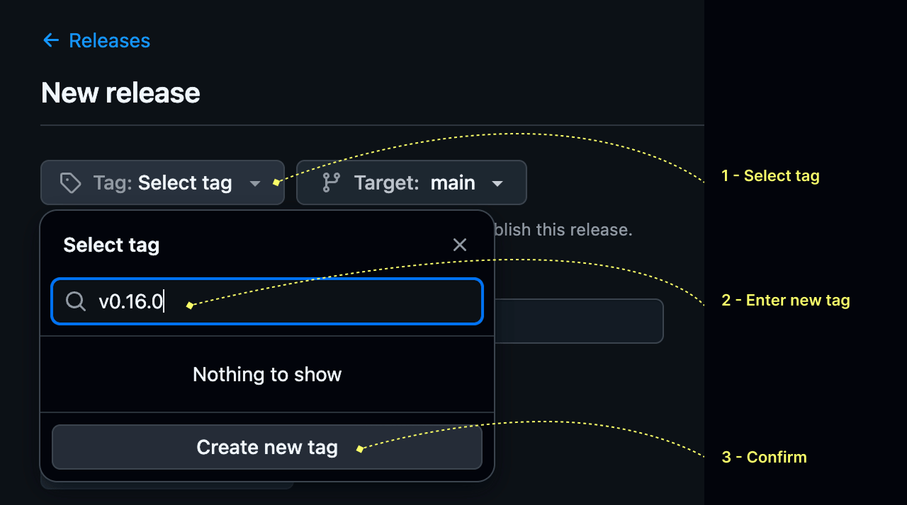
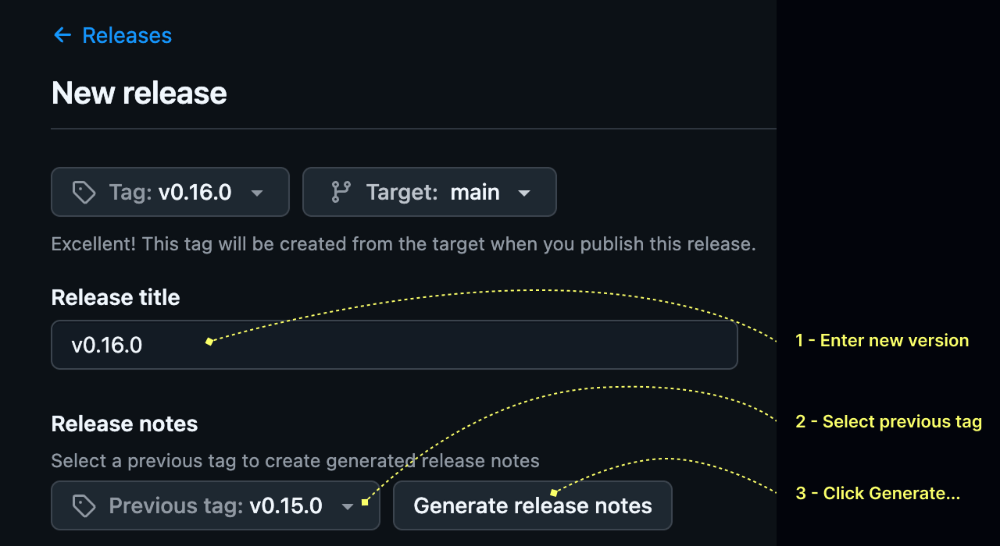
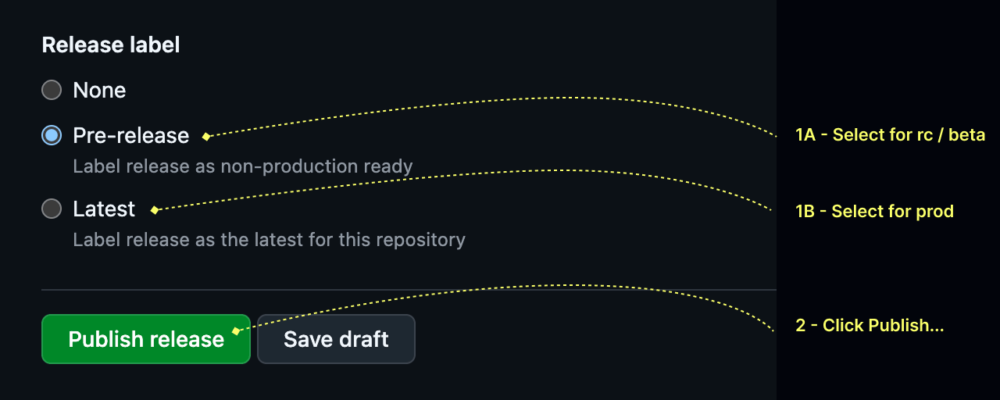

# Publish a release

A release is a GitHub release with a tag such as `v0.15.0`. When you publish it, the workflow
"Publish to npm" (`.github/workflows/publish.yml`) does the rest. It builds the package,
publishes it to npm, updates `CHANGELOG.md`, deletes the used changesets, and writes the release
notes. You do not run `changeset version` yourself.

## Tags and npm dist-tags

The tag decides the npm dist-tag (the label that people install with, for example `@latest`):

| Tag                                         | npm dist-tag | Rule                                            |
| ------------------------------------------- | ------------ | ----------------------------------------------- |
| `vX.Y.Z`                                    | `latest`     | Must be newer than the current `latest` on npm. |
| `vX.Y.Z-rc1`, `vX.Y.Z-rc.1`, `vX.Y.Z-beta1` | `rc`         | Select "Set as a pre-release".                  |
| `vX.Y.Z-alpha1`                             | `alpha`      | Select "Set as a pre-release".                  |
| Any other suffix, for example `-next1`      | none         | The workflow stops before it builds anything.   |

> [!WARNING]
> The checkbox "Set as a pre-release" must agree with the tag: selected for `rc` and `alpha`, not
> selected for `latest`. If they disagree, the workflow stops and publishes nothing.

> [!NOTE]
> The `beta` dist-tag is retired. Install `@rc` instead of `@beta`.
> You cannot release a `-canary.*` tag. Canaries are published automatically, see
> [Canary releases](#canary-releases).

## Steps

1. Open the [releases page](https://github.com/ClickHouse/click-ui/releases) and check the latest
   release. Maybe it already has the changes you need.
2. Draft a [new release](https://github.com/ClickHouse/click-ui/releases/new).
3. Create the tag. Use the next version after the latest release: `vX.Y.Z` for a release,
   `vX.Y.Z-rc1` for a release candidate. 
4. Leave the description empty, or click "Generate release notes". The workflow writes the final
   notes in both cases. 
5. For an `rc` or `alpha` tag, select **"Pre-release"** label. For regular "production" release leave label at **"Latest"**.  
   Publish the release. 
6. Wait for the [workflow run](https://github.com/ClickHouse/click-ui/actions/workflows/publish.yml)
   to finish. If the workflow rejects the release, the run summary tells you why.
7. Check the new version on [npm](https://www.npmjs.com/package/@clickhouse/click-ui) and check
   the release notes on GitHub. You can edit the notes now. The workflow does not touch them again.

## Changelog and release notes

Each pull request usually adds a changeset, a small Markdown file in `.changeset/`. The release consumes
the pending changesets: it writes their text into `CHANGELOG.md` and deletes the files.

- A release (`vX.Y.Z`) runs `changeset version` and sets the new `CHANGELOG.md` heading to the
  tag's version. It commits `CHANGELOG.md` and the deleted changesets together with the version
  bump.
- A release candidate (`vX.Y.Z-rc1`) does not touch `CHANGELOG.md` or the changesets. They wait
  for the final release.
- Both write the release notes. GitHub's own notes give "What's Changed", "New Contributors" and
  the compare link. The changesets give "⚠️ Upgrade notes" (major changes, and changesets that
  start with **Breaking:**) and "Good to know" (all other changesets). The workflow replaces the
  text that was in the release body, so edit the notes after the run.
- If no changeset is pending, the release still publishes. The run summary shows a warning, and
  the notes contain GitHub's notes only.
- A manual run of the workflow (Actions, "Run workflow", with a tag) does the same to
  `CHANGELOG.md` and the changesets. It creates no GitHub release, so it writes no notes.

## Canary releases

Every push to `main` publishes a canary to the npm dist-tag `canary`:

```sh
npm i @clickhouse/click-ui@canary
```

- The version is `<next>-canary.g<sha>.0`, for example `0.14.0-canary.g1979c25d.0`. `<next>` is
  the version the pending changesets would release. Below 1.0.0, a major bump counts as minor.
  With no changesets, `<next>` is the next patch version. `<sha>` is the first 8 characters of the
  commit.
- The workflow sets the version only in the build. `package.json` in the repository does not
  change, and there is no git tag. The canary Storybook shows the same version.
- Only the tip of `main` gets a canary. The workflow skips an older commit, and a version that is
  already on npm (a re-run).
- The version bump commit of a release has `[skip ci]` in its message, so it publishes no canary.

## Known limitations

- `latest` moves forward only. The workflow refuses a patch for an older release line, for
  example `v0.10.1` after `v0.11.0`. There is no override yet. Add one when it is first needed.
- Releases run one at a time, and GitHub keeps one release waiting. If you publish a third release
  while one waits, GitHub cancels the waiting one. Re-run it from the Actions tab. Canaries wait in
  their own queue and never cancel a release.
- If `main` moves while a release runs, the release fails before it publishes anything. Retry it
  with **Re-run all jobs**. A re-run of only the failed job uses the old build, which fails again,
  and the old build is deleted after a day.
- If a release fails after the package is on npm, finish the rest by hand. The run's `changelog`
  artifact (kept for a day) holds the `CHANGELOG.md` to commit together with the version bump. For
  a release, also delete the used changesets. The release notes are in the run summary. A manual
  run also needs the git tag.
- You cannot fix the "Set as a pre-release" checkbox with a re-run. Delete the release and create
  it again for the same tag.
